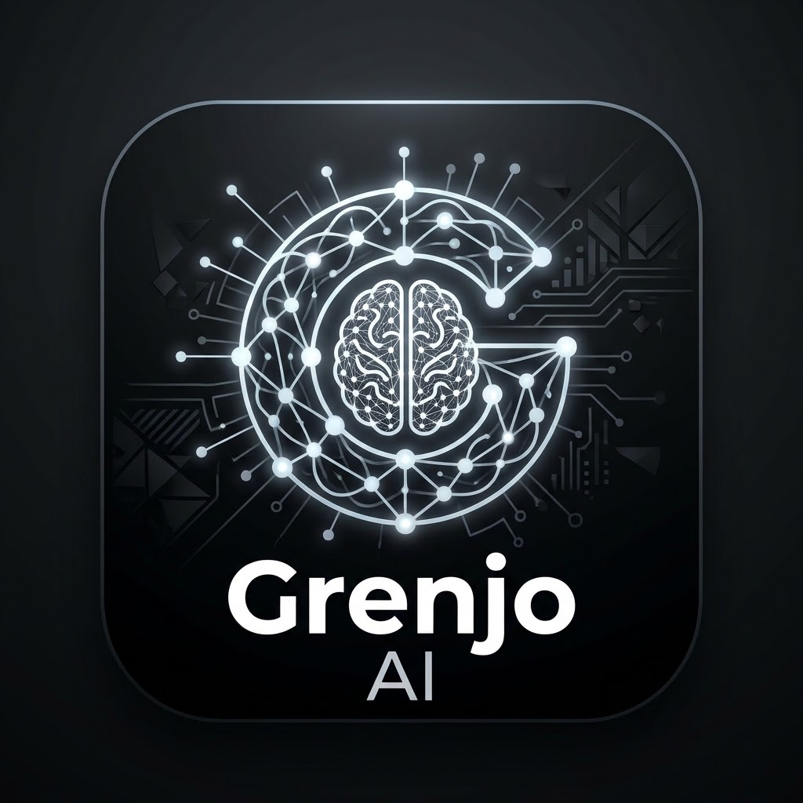

# Grenjo AI Tool

A personal AI desktop application for Windows. Chat with the models **you** choose, using
**your own** API keys, with agents, custom models and advanced generation controls — and a
local-first history that keeps working when the network does not.

Not a subscription product, not a marketplace, not multi-tenant. One user, one machine
(optionally plus a second machine through optional cloud sync).

> **Renamed from "Personal AI Desk".** The display name, executable, installer and profile
> folder are now `Grenjo AI Tool`. The first launch after the rename moves the old
> `%APPDATA%\Personal AI Desk` profile forward automatically (chats, settings, agents, custom
> models and stored API keys), and configuration files exported under the old marker still
> import. See [Renaming and data migration](#renaming-and-data-migration).



---

## What it does

| Area | What you get |
|---|---|
| **Chat** | Streaming conversations, Markdown with syntax-highlighted code, copy message/code, stop, retry, per-conversation model and agent |
| **Attachments** | Attach files or images from the native picker or by dropping them on the composer; documents are read locally (TXT, Markdown, CSV, JSON, YAML, XML, source code, PDF, DOCX) and only their text is sent; images go inline to vision models |
| **Voice** | Record a memo with a live timer, preview it, discard it, or transcribe it with OpenAI and put the text in the composer |
| **Providers** | DeepSeek, OpenAI, Google Gemini, Anthropic, and any OpenAI-compatible endpoint — add several, each with its own key |
| **Models** | Automatic discovery where the provider exposes a model-listing API, plus a **Others / Custom Models** section for models you add by hand |
| **Generation** | Temperature, top-p, top-k, frequency/presence penalty, max output tokens, stop sequences, seed, reasoning effort — the ones a model does not support are disabled with the reason, never silently dropped |
| **Agents** | Named personas: provider + model + system prompt + parameter overrides, with a defined precedence order |
| **Settings** | Readable controls plus an advanced configuration editor with per-key reset, export and import (credentials structurally excluded) |
| **Cloud sync** | Optional Supabase sync of conversations, agents, custom models, non-secret provider config and preferences. **API keys never sync.** |
| **Offline** | History, settings and agents stay readable and editable with no network; provider calls report that they could not reach the provider |

---

## Requirements

- Windows 10 or 11, x64.
- No Node.js, no VS Code and no development server needed for the installed app.
- An API key from at least one supported provider.
- Optional: a Supabase project if you want cloud sync.

---

## Install

1. Run `release/Grenjo AI Tool-Setup-0.1.0-x64.exe`.
2. The installer is **per-user** by default and installs to `%LOCALAPPDATA%\Programs\Grenjo AI Tool`.
   It creates a Start-menu entry and a desktop shortcut. You can choose another folder during setup.
3. **The installer is not code-signed.** Windows SmartScreen will warn you the first time you run
   it. That is expected: signing needs a purchased certificate. The SHA-256 of the built installer
   is recorded in [docs/FEATURES.md](docs/FEATURES.md) so you can verify what you built.
4. Launch **Personal AI Desk** from the shortcut.

**Where your data lives** — outside the install directory, so upgrades and uninstalls never touch it:

| Path | Contents |
|---|---|
| `%APPDATA%\Personal AI Desk\data\app.db` | SQLite database: conversations, messages, agents, custom models, provider configuration (no keys), settings, sync outbox |
| `%APPDATA%\Personal AI Desk\credentials.bin` | Provider API keys, encrypted with Windows DPAPI (Electron `safeStorage`) |
| `%APPDATA%\Personal AI Desk\logs\main.log` | Redacted operational log (rotates at 2 MB) |

Uninstalling removes the program and shortcuts and **keeps** `%APPDATA%\Personal AI Desk`.
Reinstalling, or installing a newer version over an older one, keeps everything as well.

---

## First run

1. **Models & Providers → Add provider.** Pick DeepSeek, OpenAI, Google Gemini or Anthropic
   (the base URL is pre-filled), or *Custom OpenAI-compatible endpoint* and enter your own URL.
   HTTPS is required except for a loopback address.
2. **Set the API key.** The field is write-only: once saved, the app shows only a fingerprint
   (`sha256(key)` prefix) so you can tell that a key is stored without it ever being displayed again.
3. **Test connection.** A success line shows the round-trip latency and how many models were found.
4. **Discover models** (optional). Results are stored locally and marked *Discovered*.
   The built-in list is only a **hint list** — discovery is authoritative.
5. **Others / Custom Models → Add model** for anything discovery does not return: exact model id,
   capabilities, limits, which parameters it honours.
6. **Chat.** Pick the model in the composer, type, press Enter (Shift+Enter for a newline).
   Stop is available while a reply streams.

### Attaching files, images and voice

- **Attach file** opens the Windows file picker. Text documents are read on this machine and
  their text is placed in the message, fenced with the filename — the model is told what came from
  a file. PDF and DOCX are parsed with `unpdf` and `mammoth`; an encrypted or corrupt document is
  reported as **"contents not read"** with the reason, never quietly dropped.
- **Attach image** sends PNG/JPEG/WebP/GIF inline, in the format each provider documents
  (`image_url`, Anthropic `image` blocks, Gemini `inlineData`). Only a model whose capabilities say
  it accepts images will take one; otherwise the composer says so and refuses the send rather than
  pretending the image was seen.
- **Record voice** asks for the microphone once, shows a timer, and gives you Stop, Cancel, a
  preview, and **Transcribe**. Transcription goes to OpenAI (`whisper-1`) and needs an **OpenAI API
  key** — if none is configured the app tells you exactly that instead of failing silently.
- Limits: 25 MB per file, 8 attachments per message, 60,000 extracted characters per document
  (truncated with a marker), 8 MB per image, 5 minutes / 20 MB per recording.
- The original files stay where they are. Document text is sent; image bytes are sent to the
  provider you chose; nothing is uploaded until you actually send or press Transcribe.

---

## Development

```powershell
npm install
# npm 11 blocks dependency install scripts; Electron's binary needs one step:
node node_modules/electron/install.js

npm run dev          # Vite dev server + Electron, with rebuild-on-change
```

`npm run dev` starts the renderer dev server on `http://127.0.0.1:5273` and launches Electron
against it. Changes under `src/renderer` hot-reload; changes under `src/main` and `src/preload`
rebuild the bundles and restart Electron.

### Scripts

| Script | What it does |
|---|---|
| `npm run dev` | Dev server + Electron |
| `npm run build` | Builds `dist/main`, `dist/preload`, `dist/renderer` |
| `npm run typecheck` | `tsc --noEmit` for the node project and the web project |
| `npm test` | Node suites, then renderer suites |
| `npm run test:unit` / `npm run test:ui` | One side only |
| `npm run audit:gate` | Repo-wide quality gate (see below) |
| `npm run dist` | Windows NSIS installer into `release/` |
| `npm run pack` | Unpacked build only (faster) |
| `npm run smoke:packaged` | Launches the built exe, checks the preload bridge/CSP/Node isolation, writes a JSON result |
| `npm run icon` | Regenerates `build/icon.png` and `build/icon.ico` |

### Quality gate

`npm run audit:gate` fails the build on: an empty `catch`, `console.*` in application code,
`any`/`@ts-ignore`, `TODO`/`FIXME`, `window.confirm|alert|prompt`, `dangerouslySetInnerHTML`,
`service_role`, a key-shaped literal, `fetch`/XHR/WebSocket in the renderer, or a token in
localStorage. It exists so the rules do not depend on anyone remembering them.

---

## Testing

```powershell
npm test
```

- Node side (`vitest.node.config.ts`): persistence and migrations, provider request formatting and
  streaming parsers, chat orchestration (streaming, cancel, error, precedence), credential store,
  settings export/import, sync engine (conflicts, retries, offline, serialization) and the RLS guard.
- Renderer side (`vitest.renderer.config.ts`): UI primitives, the dialog focus contract, the chat
  stream/error/copy behaviour, and every page's empty/loading/error states.

Every provider test runs **offline** against recorded request/response fixtures: no key, no network.
That means request construction and parsing are proven; whether a live provider accepts them is not,
and the app never pretends otherwise.

The packaged application is verified by `npm run smoke:packaged`, which asserts from inside the
shipped runtime that `window.api` exists, `window.require` and `window.process` are undefined,
React mounted, the CSP meta tag survived the build, and `userData` is outside the install directory.

---

## Providers

| Provider | Endpoint shape | Auth | Notes |
|---|---|---|---|
| DeepSeek | OpenAI Chat Completions | `Authorization: Bearer` | No top-k, no seed — those controls stay disabled |
| OpenAI | OpenAI Chat Completions | `Authorization: Bearer` | top-k is not part of this API, so it is disabled |
| Google Gemini | `generateContent` / `streamGenerateContent?alt=sse` | `x-goog-api-key` | Its own body shape (`contents`, `generationConfig`), not the OpenAI schema |
| Anthropic | Messages API | `x-api-key` + `anthropic-version` | System prompt is a top-level field; `max_tokens` is mandatory |
| Custom compatible | OpenAI Chat Completions | `Authorization: Bearer` | Model discovery at `GET {base}/models`, often unsupported — add models manually |

**Weirdness** is not a universal parameter. It is forwarded verbatim only to a model that declares
support (custom models can). Otherwise the control is disabled, and the app offers an explicitly
labelled *creativity bias* that shifts temperature and top-p locally — and says so on screen.

---

## Cloud sync (optional)

The app is fully usable without it. Setup steps, the exact SQL and the RLS verification query live
in [supabase/README.md](supabase/README.md). In short:

1. Create a Supabase project.
2. Run `supabase/migrations/0001_init.sql`, then `0002_rls.sql` in the SQL editor.
3. Copy the project URL and the **publishable/anon** key into *Cloud Sync* in the app.
   The key is written to the Windows credential store, not to SQLite.
4. Sign up, sign in, *Sync now*.

**Never** paste a `service_role` key into this app. It bypasses Row Level Security; the app refuses
such a key and the repository contains none.

---

## Security model

The short version; the full model is in [docs/THREAT-MODEL.md](docs/THREAT-MODEL.md).

- Renderer: `contextIsolation`, `sandbox`, no Node integration, no webview, no new windows, and a
  CSP with `default-src 'none'` / `connect-src 'none'` — the renderer performs **no** network I/O.
- Electron fuses flipped before packaging: Run-As-Node off, `NODE_OPTIONS` off, CLI inspect off,
  `OnlyLoadAppFromAsar` on, embedded asar integrity validation on. Verified: with
  `ELECTRON_RUN_AS_NODE=1` set, the shipped executable still refuses to become a Node interpreter.
- Main: every IPC channel validates its payload with zod and checks the caller is the app's own window.
- Keys: OS credential store only (DPAPI). Never in SQLite, an export, a log, an error message, the
  renderer, or the installer. Errors pass through a redactor before they are logged or shown.
- A key is **bound to the base URL you entered it for**. Change the URL and the key is discarded —
  it is never forwarded to a new host. A custom model's endpoint override is refused unless it is
  the same origin.
- Provider requests: `redirect: 'error'` — a redirect is refused rather than followed, so a
  compromised endpoint cannot bounce your key to another host.
- Model output: rendered as Markdown with raw HTML disabled; `javascript:` and non-HTTPS links are
  not followed.
- Supabase: RLS enabled and forced on every synced table with owner-only policies; a test parses the
  SQL and fails if a policy disappears.

### Error codes across the bridge

Electron's `contextBridge` keeps only the `message` of a thrown value — a custom property is
silently dropped (verified with a probe, not assumed). So the IPC layer returns an envelope, and
the preload throws an `Error` whose message is `code: sentence`, which the renderer's
`asAppError()` decodes. That is why a rejected call still produces "No API key is stored…" rather
than a generic failure.

---

## Project structure

```
src/
  shared/      platform-agnostic contracts: types, zod schemas, parameter resolution,
               URL policy, error model, repository/provider interfaces
  main/        Electron main process
    db/        node:sqlite connection, migrations, repositories
    providers/ five adapters + transport (the only place that performs HTTP)
    chat/      turn orchestration, precedence, streaming, cancellation
    credentials/ DPAPI-backed credential store
    sync/      Supabase client, pull/push engine, conflicts, backoff
    ipc/       the validated handler table
    security.ts CSP, permission denial, navigation guards
  preload/     the entire privileged surface exposed to the renderer
  renderer/    React 19 + token-driven CSS
supabase/      cloud schema + RLS policies + setup guide
tests/         node and jsdom suites
scripts/       dev launcher, quality gate, icon generator, packaged smoke test
docs/          threat model, feature status
```

Business logic never lives in a component: the renderer only calls `window.api`, and the provider
adapters have no Electron dependency. That is what makes a future web or mobile client a new UI
rather than a rewrite.

---

## Known limitations

See [docs/FEATURES.md](docs/FEATURES.md) for the full, current list. The ones that matter:

- **No code signing.** SmartScreen warns on first run.
- **Live provider calls are unverified in this workspace** — no API key was available, and inventing
  one is not acceptable. Request construction, parsing and error mapping are covered by offline tests.
- **Cloud sync is unverified against a real Supabase project.** The engine is tested against fakes;
  the SQL and RLS policies are test-guarded. You still have to create the project.
- **No local model execution.** Every request goes to a remote provider you configure.
- **No agent autonomy.** Agents are configurable personas; there is no tool execution or shell access
  in this release, by design.
- **Attachments are text-extraction, not vision-by-default.** A document is read as text; a scanned
  PDF with no text layer yields an explicit "no text found" rather than OCR. Tables and layout are
  flattened to plain text.
- **Images need a vision-capable model.** DeepSeek's chat models do not accept images, so the
  composer refuses to send one to them.
- **Transcription depends on OpenAI.** It is the only provider in this release with a documented
  transcription endpoint; without an OpenAI key the button explains what is missing rather than
  guessing.
- Search is `LIKE`-based, not full-text.
- **Cloud sync ordering is not server-authoritative.** Conflict detection compares a per-device
  `version` counter and each device's own clock (`updated_at`). A device with a badly wrong clock can
  mis-order a record, and a push is an unconditional upsert, so a device that pushes before pulling
  can win. For two machines whose clocks agree this behaves correctly; a `server_revision` column is
  the durable fix and is listed as future work.
- **The conflict screen shows revisions and a summary, not the remote body**, so "keep remote" is
  chosen from the description rather than a side-by-side diff.
- **The renderer bundle is ~213 kB gzip**, about 13 kB over the guideline, almost entirely the
  syntax highlighter. It loads from disk, not the network.

---

## Licence

Personal use. No licence file is shipped; do not redistribute without deciding one.
